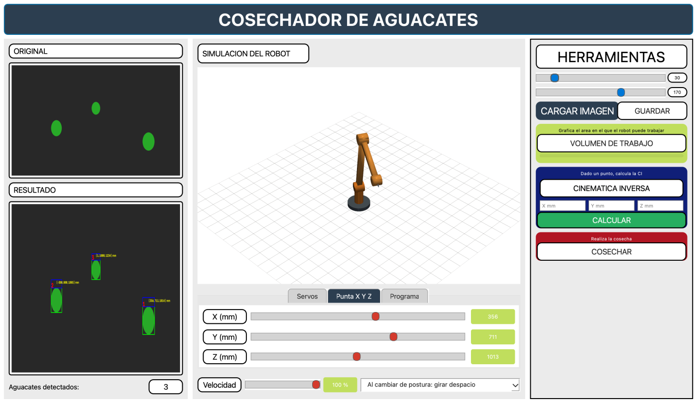
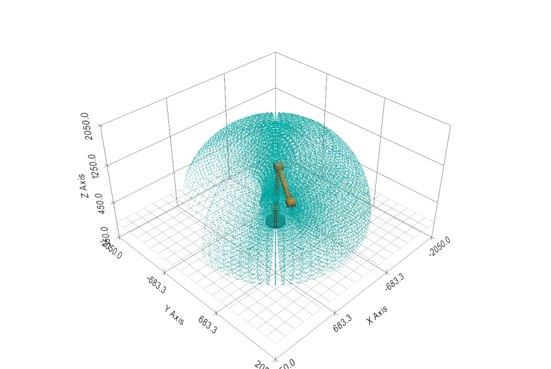

# Robot cosechador de aguacates (3 GDL)

Brazo robótico de tres grados de libertad que detecta aguacates con visión por computadora, calcula
el punto de corte del pedúnculo en milímetros y planea la trayectoria del brazo para cosecharlo.
Incluye la interfaz gráfica (PyQt5), una simulación 3D (PyVista) y el firmware de la ESP32 que mueve
los servomotores del prototipo a escala.



*La interfaz con una imagen de prueba sintética: tres aguacates detectados, cada uno con su punto de
corte en coordenadas del robot, y el brazo llevado al primero en modo «Punta X Y Z».*

## Qué hace

- **Cinemática directa** por Denavit-Hartenberg para cualquier brazo serial descrito en un archivo
  de configuración.
- **Cinemática inversa analítica** del brazo antropomórfico: prueba las cuatro soluciones (base de
  frente o girada, codo arriba o abajo) y elige una que respete el rango real de cada servo.
- **Trayectorias continuas:** ningún servo gira más de lo que alcanza en un paso. Si un movimiento
  obliga a cambiar de postura (por ejemplo, voltear la base para cruzar al otro lado), se hace
  despacio y con aviso, o se rechaza, según se elija.
- **Control cartesiano (*jog*):** se mueve la punta en X, Y o Z y el robot acomoda todas sus
  articulaciones para que vaya en línea recta.
- **Visión por computadora:** detección del aguacate por color, de sus defectos y del pedúnculo.
  Con la cámara montada en el efector, la distancia se estima por el tamaño aparente del fruto y el
  punto de corte se convierte a milímetros del robot.
- **Velocidad ajustable** sin exceder lo que aguantan los servos (SG90).
- **ESP32 virtual:** habla el mismo protocolo que el firmware, así que todo se prueba sin hardware.
  Con la placa conectada basta con indicar el puerto.



*Volumen de trabajo: todos los puntos que alcanza la punta dentro del rango de los servos.*

## Correrlo

```bash
uv venv -p 3.12 .venv && uv pip install -p .venv -r requirements.txt
.venv/bin/python -m cosechador                     # o: .venv/bin/python R_COSECHADOR_AUTONOMO.py
.venv/bin/python -m pytest -q tests                # pruebas
```

| Variable | Para qué |
|---|---|
| `ROBOT_CONFIG` | Otro robot: ruta a su YAML (también `--robot ruta.yaml`) |
| `ROBOT_PUERTO` | La ESP32 real, p. ej. `/dev/cu.usbserial-0001`. Sin ella se usa la virtual |
| `ROBOT_CAMARA` | La cámara: URL de la app del celular o índice de webcam. Sin ella, usa CARGAR IMAGEN |

### Uso rápido
1. **Pestaña Servos:** mueve cada servo en grados. **Pestaña Punta X Y Z:** mueve la punta en mm.
2. **Velocidad** y **«al cambiar de postura»** (abajo) aplican a cualquier movimiento.
3. **Cosechar:** CARGAR IMAGEN (o la cámara) → GUARDAR (guarda los pedúnculos detectados) → COSECHAR.
4. **CALCULAR:** escribe un punto en mm; el robot dice si llega, va y regresa a HOME.

## Cómo está organizado

```
robots/cosechador_3gdl.yaml   TODO lo propio del robot: tabla DH, servos, movimiento, piezas, cámara, visión
cosechador/
  robot/        descripción (YAML), cinemática directa e inversa, volumen. Sin Qt ni PyVista
  vision/       detección por color y cámara pinhole (píxel -> mm del robot)
  hardware/     enlace con la ESP32 (real por serial o virtual)
  movimiento/   planea trayectorias continuas; devuelve la lista de pasos
  ui/           ventana Qt (.ui editable en Qt Designer) y escena 3D
modelos/        piezas 3D (STL/STEP), generador por código y comparador (ver modelos/README.md)
tests/          pruebas automáticas (incluye un segundo robot de 4 GDL para probar que es genérico)
ROBOT_ESP32_CODIGO.ino         firmware de la ESP32
```

Cada capa solo depende de las de arriba: `robot/` no sabe que existe una ventana, y `ui/` no calcula
nada; solo ejecuta lo que planea `movimiento/` y dibuja lo que dice `robot/`.

## Otro robot

1. Copia `robots/cosechador_3gdl.yaml` y cambia la tabla DH, los servos y las piezas.
2. `python -m cosechador --robot robots/mi_robot.yaml`.

Si el archivo trae un error, la app dice qué campo está mal. Cualquier brazo serial descrito con DH
se carga, se dibuja y se mueve con los sliders de servos. Calcular trayectorias necesita un solver
de cinemática inversa para su topología (`cinematica_inversa:`); hoy existe `antropomorfico_3r`.
Ejemplo: `tests/robots/brazo_4gdl.yaml`.

## Prototipo físico

Prototipo a escala con servomotores SG90 y una ESP32 (`ROBOT_ESP32_CODIGO.ino`): recibe por serial
los ángulos `t1,t2,t3` y valida el rango de cada servo. *Videos del prototipo: próximamente.*

## Siguientes pasos

- Guardar y repetir movimientos (pestaña «Programa»).
- Acercamiento lento al fruto para no maltratarlo.
- Piezas modeladas en CAD (Onshape) en lugar de las provisionales.
- Calibración de la cámara con tablero de ajedrez.
